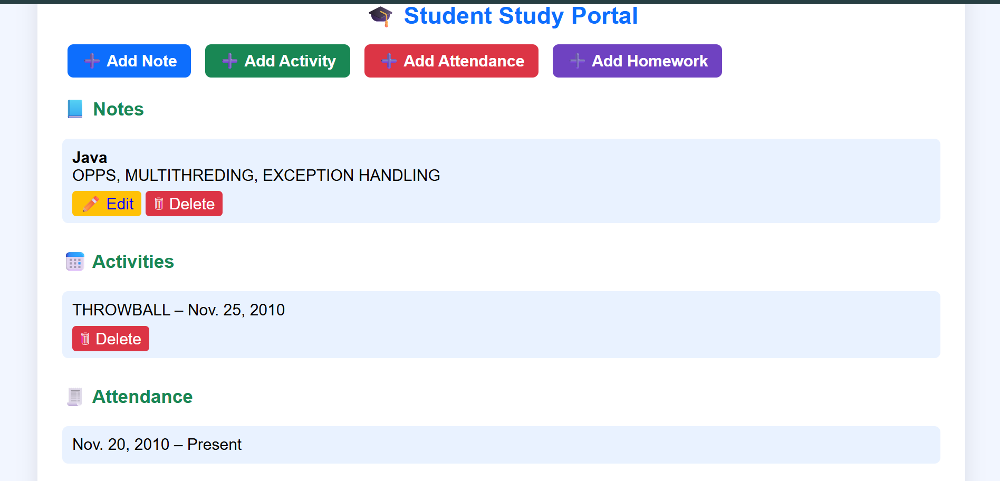

# 📚 Student Study Portal

A web-based application built using **Django** to help students manage their daily academic activities, including study notes, daily activities, attendance, and homework in one place.

## 🚀 Features

- ➕ Add, view, edit, and delete Study Notes
- 🗓️ Track Daily Activities
- ✅ Record Attendance
- 📘 Manage Homework
- 🛠️ Django Admin Panel for managing data
- 🎨 Clean and colorful user interface
- 🗂️ Organized Django MVT architecture

## 📸 Dashboard Preview



## 🧰 Technologies Used

- **Backend:** Python, Django
- **Frontend:** HTML, CSS
- **Database:** SQLite
- **Version Control:** Git & GitHub

## 📂 Project Structure

```text
student-study-portal/
│
├── portal/
│   ├── migrations/
│   ├── templates/
│   ├── models.py
│   ├── views.py
│   └── urls.py
│
├── student_portal/
│   ├── settings.py
│   └── urls.py
│
├── manage.py
├── README.md
└── student-portal-dashboard.png
```

## ⚙️ How to Run Locally

1. Clone the repository:

   `git clone https://github.com/Poojagowds/student-study-portal.git`

2. Navigate into the project:

   `cd student-study-portal`

3. Install Django:

   `pip install django`

4. Apply migrations:

   `python manage.py migrate`

5. Start the development server:

   `python manage.py runserver`

6. Open `http://127.0.0.1:8000/` in your browser.

## 👩‍💻 Developed With

Python and Django